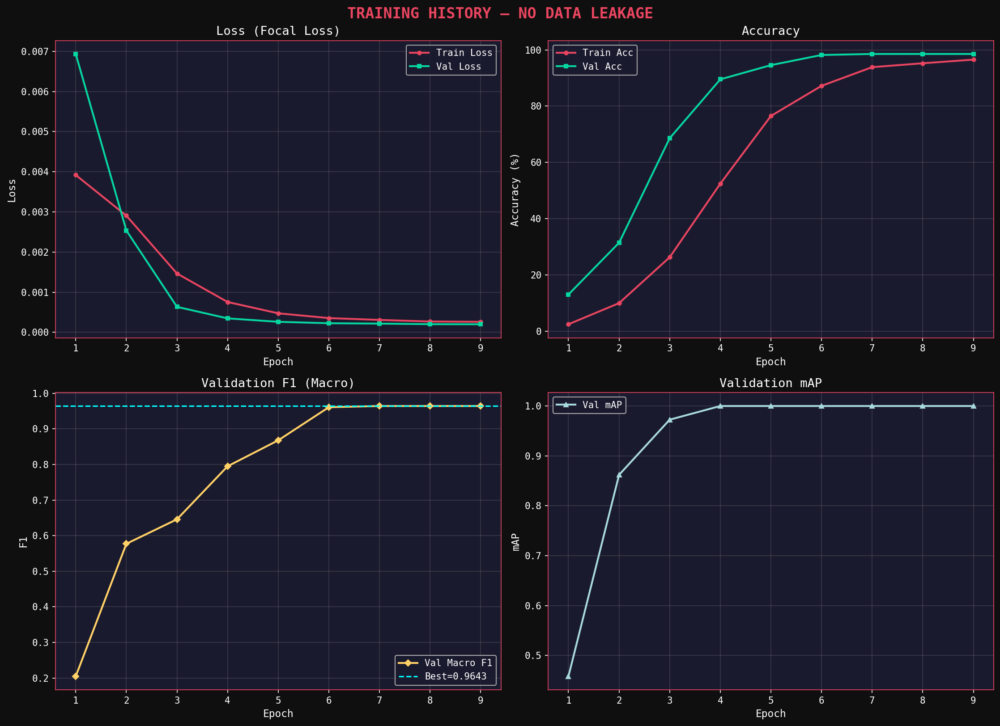

# Dark-pattern detector

Flags manipulative interface design ("dark patterns") such as fake urgency, hidden costs and guilt-worded opt-outs. A multimodal model reads a screenshot and its text together; a Chrome extension highlights detections on live pages, maps each one to the consumer-protection rules it may breach, and exports a PDF report.



## Parts

| Path | What it is |
| --- | --- |
| `extension/` | Chrome extension (Manifest V3): scans page elements, highlights detections, shows law mappings, exports a PDF report |
| `server/model_server.py` | Local Flask server the extension calls. Runs the model, with a keyword-rule fallback when no model file is present |
| `server/post_process_duplicates.py`, `server/diagnostic_duplicates.py` | Remove repeated detections of the same element |
| `server/test_xai.py` | Checks the explanation endpoint |
| `training/dark_pattern_multimodal.ipynb` | Data preparation, training, ablation and explainability (Kaggle notebook) |
| `training/separate_dataset.py` | Splits the raw dataset into web, app and mobile subsets |
| `test_pages/` | One page full of dark patterns and one clean page, for trying the extension |

## Model

- **Image branch:** Vision Transformer (ViT) on the screenshot.
- **Text branch:** RoBERTa on the accompanying text.
- **Fusion:** cross-modal attention between the two, then a classifier over 27 dark-pattern categories.
- **Explanations:** Grad-CAM on the image branch and attention maps, so a reviewer can see what drove a decision.

Data: 1,999 labelled samples in 27 categories, split 1,399 / 300 / 300 before any preprocessing. 277 of the 300 test samples have a usable image.

## Results

Ablation on the test set, from the notebook in this repository:

| Model | Accuracy | Macro F1 | mAP |
| --- | --- | --- | --- |
| ViT only (image) | 92.8% | 0.772 | 0.952 |
| RoBERTa only (text) | 100% | 1.000 | 1.000 |
| Fusion (ViT + RoBERTa) | 100% | 1.000 | 1.000 |

An earlier run of the fusion model after the split was fixed scored 98.6% accuracy and 0.964 macro F1 ([chart](docs/test-metrics.png)).

**Read these numbers with care.** The text given to RoBERTa in this dataset is a description of the pattern, and that description largely names the category. A text model that scores 100% on its own is reading the label, not detecting it. The image-only figure, 92.8% accuracy and 0.772 macro F1, is the fair estimate of what the model does from a screenshot. On a live page the text is whatever the site wrote, so the extension combines the model with keyword rules and confidence thresholds instead of trusting the text branch alone.

The first version of this project also memorised its training set because preprocessing ran before the split. That was found and fixed; the notebook now splits first and fits every transform on the training split only.

## Run it

**1. Server**

```bash
cd server
python -m venv .venv
.venv\Scripts\activate          # Windows; use `source .venv/bin/activate` on Linux or macOS
pip install -r requirements.txt
python model_server.py
```

The server listens on http://127.0.0.1:5000. It looks for `best_model_no_leakage.pt` next to `model_server.py`. The trained weights are about 2.5 GB and are not stored in this repository; train them with the notebook. Without the file the server still runs, using the keyword rules only.

**2. Extension**

1. Open `chrome://extensions`, switch on Developer mode, choose **Load unpacked** and select the `extension/` folder.
2. Open `test_pages/test_dark_pattern.html`, or any site, and start a scan from the extension popup.

The extension only talks to the local server. Page content is not sent anywhere else.

## Limits

- 1,999 samples across 27 categories is small; several categories have few examples, which is why macro F1 trails accuracy for the image branch.
- The law mappings are a guide for a reviewer, not legal advice.

## Author

Muhammad Umer Khan, [Neurals Solutions](https://neuralssolutions.com)

## License

MIT. See [LICENSE](LICENSE).
